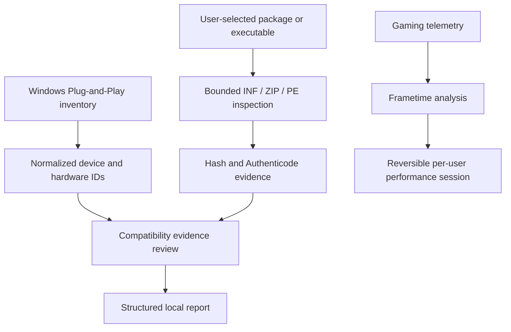

# OPlague — Device, Driver and Gaming Workbench

**A local desktop workbench for device and driver inspection, compatibility evidence, package analysis and gaming-performance diagnostics.**

<p align="center">
  
</p>

<p align="center">
  <a href="assets/screenshots/oplague-workbench.png">
    
  </a>
</p>

<p align="center">
  [](https://github.com/Ivan-VHS/OPlague/actions/workflows/desktop-build.yml)
  [](https://github.com/Ivan-VHS/OPlague/actions/workflows/docs.yml)
  [](LICENSE)
</p>

[English](README.md) · [Українська](README.uk.md) · [Русский](README.ru.md) · [简体中文](README.zh-CN.md)

**Default boundary:** inspection is read-only. Device discovery and user-selected file analysis do not install, enable, unload or modify drivers. Compatibility candidates and telemetry are evidence for review, not certification.

## Inspection and evidence flow



The diagram shows separate evidence and telemetry paths. It does not imply automatic driver installation, package execution or hardware certification.

## Capabilities

| Work area | What it provides |
|---|---|
| Device inventory | Windows Plug-and-Play inventory and normalized hardware identifiers |
| Package review | Bounded INF/ZIP inspection and UDRV package validation |
| Binary evidence | PE inspection, Authenticode metadata, hashes and SPDX inventory |
| Compatibility | Device/package evidence and structured reports |
| Gaming diagnostics | Local telemetry, frametime analysis and reversible per-user performance sessions |

See [Features](docs/FEATURES.md), [Architecture](docs/ARCHITECTURE.md), [Authenticode](docs/AUTHENTICODE.md), [Driver target architecture](docs/DRIVER_TARGET_ARCHITECTURE.md), [UDRV format](docs/UDRV_FORMAT_V1.md) and [Gaming workbench](docs/GAMING_PERFORMANCE_WORKBENCH.md).

## Run and test

Requirements: Python 3.10–3.12 for the current desktop tools and validation scripts.

```sh
python oplague_app.py
python -m unittest discover -s tests -v
python -m oplague --verify
python -m oplague --catalog
```

Inspect a package:

```sh
python tools/udrv_inspector.py path/to/package.udrv --json
```

Build a standalone Windows executable with PyInstaller:

```sh
python -m pip install --upgrade pyinstaller
python -m PyInstaller --noconfirm --clean --onefile --windowed --name OPlague oplague_app.py
```

## Safety and integration

- The workbench does not flash firmware or install drivers.
- Package inspection is bounded and does not execute inspected payloads.
- Compatibility candidates are evidence for human review, not an automatic certification result.
- [Reaper runtime integration](docs/REAPER_RUNTIME_INTEGRATION.md)
- [DuckOS and Mora integration](https://github.com/Ivan-VHS/DuckOS/blob/main/docs/GAMING_PERFORMANCE_INTEGRATION.md)
- [Shared ecosystem standards](https://github.com/Ivan-VHS/DuckOS/blob/main/docs/SHARED_STANDARDS.md)

Source, schemas and tests define current behavior. No automatic driver install, firmware update or hardware compatibility certification is claimed.

[Documentation index](docs/README.md) · [Contributing](CONTRIBUTING.md) · [Security policy](SECURITY.md) · [Apache-2.0](LICENSE)
