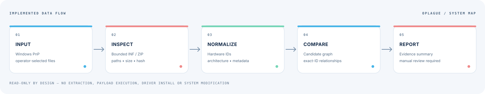
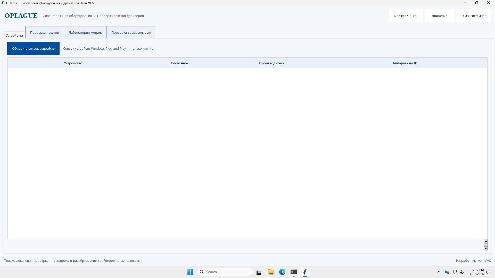

# OPlague

OPlague is a local workbench for Windows device inventory, read-only driver-package inspection and evidence-based compatibility review for support engineers, hardware reviewers and QA teams.

[English](README.md) · [Українська](README.uk.md) · [Русский](README.ru.md) · [简体中文](README.zh-CN.md)

<picture><source media="(prefers-color-scheme: dark)" srcset="assets/readme/dashboard.svg"></picture>

  

[Quick Start](#quick-start) · [Screenshots](#screenshots) · [Architecture](#architecture) · [Roadmap](#roadmap) · [Docs](docs/README.md) · [Commits](https://github.com/Ivan-VHS/OPlague/commits/main)

> **Status:** Active development. Tkinter desktop workbench, local package inspectors, CLI tools, tests and Windows packaging workflow are present. Live Plug and Play inventory is Windows-only.
> **Requirements:** Python 3.10+, Tkinter for desktop UI and Git. Live PnP collection additionally requires Windows and PowerShell/CIM.

## Reaper integration

OPlague optionally delegates a narrow, validated integer-expression operation to Reaper's versioned C17 ABI. Reaper is not used to inspect or modify drivers, authorize installation, or produce device-compatibility verdicts. The Python device/package workbench remains authoritative; the ABI bridge is opt-in and uses an explicitly selected trusted library. See [Reaper runtime integration](docs/REAPER_RUNTIME_INTEGRATION.md).

## Quick Start

Launch the desktop workbench:

~~~sh
python oplague_app.py
~~~

Run checks and tests:

~~~sh
python -m compileall -q oplague_app.py oplage_app.py tests
python tools/validate_visual_canon.py ui_theme.py
python -m unittest discover -s tests -v
~~~

Inspect local files:

~~~sh
python tools/pe_inspector.py driver.sys --output driver-pe-report.json
python tools/sbom_inventory.py ./staging --output staging.spdx.json
python tools/udrv_inspector.py path/to/package.udrv --json
~~~

## What it does

| Area | Implemented behavior | Boundary |
|---|---|---|
| Device inventory | Reads Windows PnP identity, status, manufacturer and PNPDeviceID | Windows-only, read-only |
| INF inspection | Reads metadata, hardware-ID declarations and target architecture | Does not run INF directives |
| ZIP inspection | Checks paths, sizes, compression ratios, hashes and INF metadata | Does not extract or execute payloads |
| PE/COFF inspection | Reads machine type, headers, sections, entry point and certificate-table location | Header analysis only; no image loading or signature verdict |
| SPDX inventory | Creates deterministic SPDX 2.3 file/hash reports | No inferred dependency graph or license conclusion |
| Compatibility graph | Forms candidates from exact normalized hardware IDs | Manual review remains necessary |
| Metric Lab | Compares supplied normalized profiles | Advisory, not a device verdict |
| UDRV v1 | Validates manifest, sizes and SHA-256 evidence | Integrity check, not publisher authentication |
| Gaming lab | Reversible Windows power-plan sessions, snapshots and frametime/CSV analysis | No driver patching |

OPlague does **not** install, load, extract, remove or modify drivers. Hardware-ID matches and hashes are evidence inputs, not proof of compatibility, safety, publisher identity or ownership.

## Why OPlague

- Separates live device observations from operator-selected files and test fixtures.
- Inspects package metadata within explicit input and expansion bounds.
- Produces explainable candidate links and structured evidence, not automatic install decisions.
- Keeps inspection non-executing: payloads are not extracted or run.
- Provides a local gaming-performance workflow without claiming kernel, driver or firmware tuning.

## Screenshots

<picture><source media="(prefers-color-scheme: dark)" srcset="assets/readme/workflow-dark.svg"></picture>

Real 1920×1080 Windows capture from the desktop packaging workflow. The flow graphic above is an architecture illustration.

## Architecture

~~~mermaid
flowchart LR
 A[Windows PnP or chosen file] --> B[Bounded metadata parser]
 B --> C[Normalized IDs and hashes]
 C --> D[Candidate comparison]
 D --> E[Evidence report]
 F[User metrics] --> D
~~~

| Path | Responsibility |
|---|---|
| oplague_app.py | Public desktop entry point |
| oplage_app.py | Desktop implementation, package inspection and PnP query |
| tools/ | CLI inspectors, report composition, metrics and UDRV utilities |
| tests/ | Unit/regression tests and local fixtures |
| docs/ and schemas/ | Architecture, safety boundaries and versioned contracts |
| assets/screenshots/ | Captured Windows desktop evidence |

## Input limits

| Input | Limit |
|---|---:|
| INF / ZIP package file | 512 MiB |
| ZIP entries | 10,000 |
| Total expanded ZIP content | 2 GiB |
| Individual INF content | 2 MiB |
| ZIP compression ratio | 200:1 |
| UDRV manifest | 4 MiB |
| UDRV entries | 10,000 |

The UDRV inspector hashes bounded chunks and does not unpack or execute payloads. Metric Lab uses operator-supplied normalized JSON; starter values are examples, not live measurements.

## Compatibility

| Platform | Capability |
|---|---|
| Windows | Desktop UI, live PnP inventory, package inspection and gaming sessions |
| Linux | Source launch and saved-data/package inspection; no live Windows PnP |
| macOS | Saved-data/package inspection only; system integration is not claimed |
| Python | 3.10+ |
| Windows packaging | PyInstaller; CI uses Python 3.12 |

~~~sh
python -m pip install --upgrade pyinstaller
python -m PyInstaller --noconfirm --clean --onefile --windowed --name OPlague oplague_app.py
~~~

The executable is written under dist/OPlague.exe.

## Revival highlights

- The read-only boundary and Windows-only live inventory are visible before setup.
- The application capture and architecture illustration are separate local assets.
- Light/dark artwork uses equal-size, repository-local SVG variants.
- File bounds, safety limits and test commands are easy to scan.

| Previous reading flow | Updated reading flow |
|---|---|
| Long scope section before launch | Desktop start and test commands first |
| Broad driver-analysis claims | Explicit read-only and evidence boundaries |
| Fixed-theme visual | Adaptive SVG artwork |
| Limits dispersed through prose | Compact input-limit table |

## Roadmap

- [x] Read-only PnP inventory and bounded INF/ZIP inspection.
- [x] PE/COFF header inspection, SPDX file inventory and UDRV v1 validation.
- [x] Candidate compatibility graph with manual-review boundary.
- [x] Reversible Windows power sessions and local performance analysis.
- [ ] Extend trust verification only with independent evidence, tests and explicit operator review.

## Ecosystem

- [DuckOS](https://github.com/Ivan-VHS/DuckOS) — operating-system project and Mora workspace; OPlague remains independently scoped.
- [Reaper](https://github.com/Ivan-VHS/Reaper) — systems language and developer workbench.
- [Pytyliki](https://github.com/Ivan-VHS/Pytyliki) — processor inspection and bounded systems utilities.
- [VentuSample](https://github.com/Ivan-VHS/VentuSample) — procedural sample generation and offline DSP.

See [documentation](docs/README.md), [architecture](docs/ARCHITECTURE.md), [contributing](CONTRIBUTING.md) and [issues](https://github.com/Ivan-VHS/OPlague/issues). License: [Apache-2.0](LICENSE).
