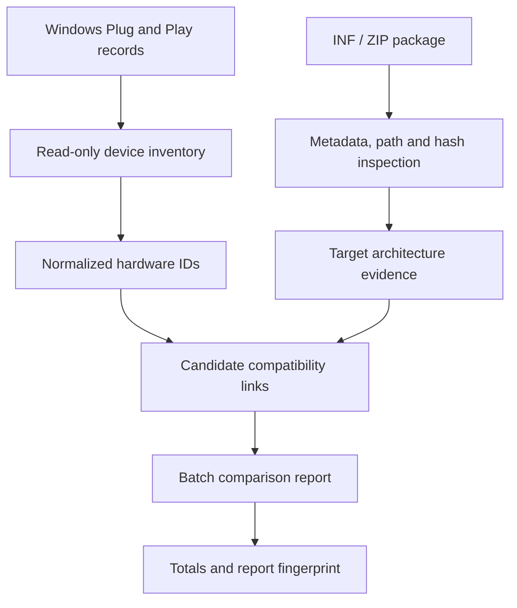
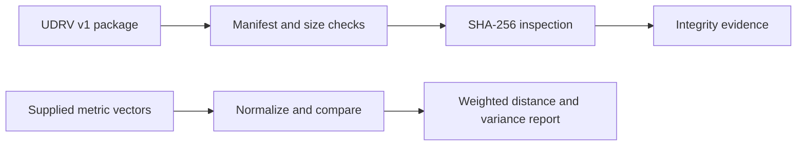

# OPlague — Driver Workbench

> Documentation synchronized with the implementation on 2026-11-21; the Windows screenshot is generated by the desktop-build workflow.
[Windows desktop build](https://github.com/Ivan-VHS/OPlague/actions/workflows/desktop-build.yml) · [CI](https://github.com/Ivan-VHS/OPlague/actions) · Python 3.10+ · Windows · Apache-2.0
**Developer:** [Ivan-VHS](https://github.com/Ivan-VHS)

**OPlague is a read-only workbench for Windows device inventory, driver-package inspection and evidence-based comparison. It does not install, load or modify drivers.**

[English](README.md) · [Русский](README.ru.md) · [Українська](README.uk.md) · [简体中文](README.zh-CN.md)

## Live Windows workbench

<p align="center"></p>

<sub>Actual application capture · 1920×1080 source image · original pixels retained; no artificial upscaling.</sub>

Device and package relationships are presented as evidence for operator review; no driver installation is triggered.

## Functional data flow

The diagram summarizes implemented data movement between Windows device records, package inspection and report generation.



## Package and metric processing

The second flow describes package integrity inspection and numeric analysis of supplied vectors.



## Workbench modules

| Module | Evidence / output | Boundary |
|---|---|---|
| Device inventory | Plug and Play identity, status and hardware IDs | read-only discovery |
| INF / ZIP inspection | metadata, hashes, paths and resource limits | no package execution or driver installation |
| Architecture review | INF target architecture vs host architecture | evidence, not a compatibility verdict |
| Compatibility graph | exact normalized hardware-ID relationships | candidate links only |
| UDRV v1 | manifest, payload sizes and SHA-256 | integrity inspection; no install/load |
| DRIVE-LENS | provenance, HMAC pseudonyms and attribute/time-window grouping | no automatic verdict |
| Batch reports | ordered results, totals and report fingerprint | no system write |
| Metric Lab | normalized vectors, weighted distance and variance | advisory analysis of supplied data |
| Clinical Systems | 120 principle records and 36 telemetry checks | operational guidance, not medical or device certification |
| Impact Profiles | 20 searchable semantic profiles with five ordinal dimensions | lexical catalogue only; no hardware inference |
| Atomic-Quantum 133 | 133 stable operation IDs and read-only simulation-report validation with provenance, time windows, units and uncertainty | advisory evidence only; no device control |

## Run and test

Start the Windows desktop workbench:

```sh
python oplague_app.py
```

Run the test suite and inspect semantic impact profiles:

```sh
python -m unittest discover -s tests -v
python -m oplague --verify
python -m oplague --catalog
python -m oplague --search "баллистический"
python -m oplague --profile 5
python -m oplague --rank reach
# Optional: use Reaper C17 to total five validated ordinal dimensions
python -m oplague --rank-total-native --reaper-library /absolute/path/to/libreaper_ffi.so
python tools/udrv_inspector.py path/to/package.udrv --json
python tools/clinical_systems.py --catalog --pretty
```

The Windows desktop workflow validates the visual canon and tests, builds the standalone `OPlague.exe`, captures the running app and publishes a Windows x64 archive.

## Optional Reaper C17 runtime

OPlague can optionally delegate ordinal impact-profile total calculations to Reaper's native C17 expression ABI. This requires an explicit trusted library path; no runtime library discovery or download occurs. See [Reaper runtime integration](docs/REAPER_RUNTIME_INTEGRATION.md).

## Numeric reference

| INF target | PE machine |
|---|---:|
| NTx86 | `0x014C` |
| NTamd64 | `0x8664` |
| NTarm | `0x01C4` |
| NTarm64 | `0xAA64` |
| NTia64 (legacy) | `0x0200` |

UDRV v1 limits: manifest ≤4 MiB · entries ≤10,000 · file ≤512 MiB · total payload ≤2 GiB · SHA-256 buffer 1 MiB.

Exact ID or hash matches do not prove publisher trust, OS compatibility, device suitability or safe installation. HMAC pseudonyms and report fingerprints aid consistency and provenance; they do not establish authenticity by themselves.

[Documentation index](docs/README.md) · [Apache-2.0 License](LICENSE)


## Code Mental Health / Codebase Wellbeing

OPlague includes an offline, read-only repository inventory, separate from device inspection, driver analytics and hardware telemetry.

```sh
python -m tools.code_wellbeing .
python -m tools.code_wellbeing . --json
```

Signals describe visible project evidence only; maintenance markers and missing files are prompts for human review, not automatic defect labels.

[Engineering charter and measurement limits](docs/CODE_MENTAL_HEALTH.md) · [Versioned contract](data/code-wellbeing/codebase-wellbeing.v1.json)

## Bounded resource-allocation reference
An illustrative 500 UAH budget model with a versioned JSON contract and an offline simulator. This is a documentation example, not a feature of the host runtime.

[Multilingual guide](docs/RESOURCE_ALLOCATION_500_UAH.md) · [Interactive simulator](docs/resource-allocation-500-uah.html) · [JSON example](examples/resource-allocation-500-uah.json) · [JSON Schema](schemas/resource-allocation.v1.schema.json)

## Cross-repository plugin federation

This repository's host adapter, shared 18-plugin catalog and compatibility rules are documented in [Plugin Federation](docs/PLUGIN_FEDERATION.md). The machine-readable host declaration is `federation/plugins/host.v1.json`.
