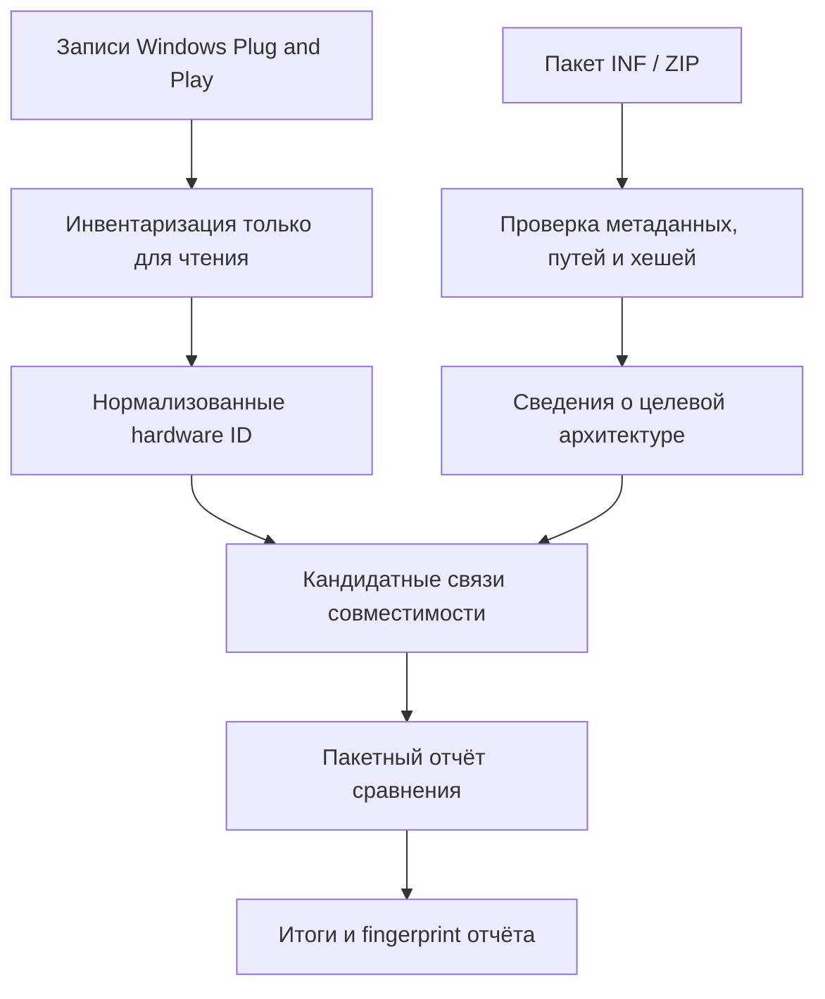
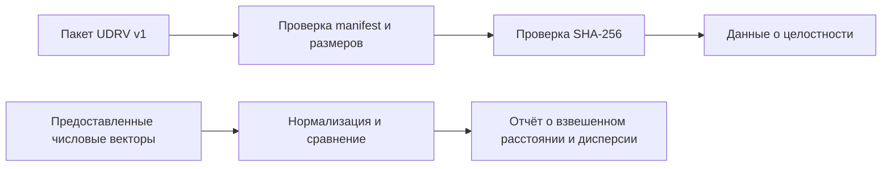

# OPlague — рабочая станция драйверов

[Сборка Windows](https://github.com/Ivan-VHS/OPlague/actions/workflows/desktop-build.yml) · [CI](https://github.com/Ivan-VHS/OPlague/actions) · Python 3.10+ · Windows · Apache-2.0
**Разработчик:** [Ivan-VHS](https://github.com/Ivan-VHS)

**OPlague — инструмент только для чтения: инвентаризация устройств Windows, анализ пакетов драйверов и сопоставление доказательств. Он не устанавливает, не загружает и не изменяет драйверы.**

[English](README.md) · [Русский](README.ru.md) · [Українська](README.uk.md) · [简体中文](README.zh-CN.md)

## Реальный снимок Windows-приложения

<p align="center"></p>

<sub>Фактический снимок приложения · исходное изображение 1920×1080 · исходные пиксели сохранены, искусственное увеличение не применяется.</sub>

Связи устройств и пакетов представлены как данные для проверки оператором; установка драйвера не запускается.

## Поток функциональных данных

Схема показывает реализованное движение данных между записями устройств Windows, анализом пакетов и формированием отчёта.



## Проверка пакетов и обработка метрик

Вторая схема описывает проверку целостности пакета и численный анализ предоставленных векторов.



## Модули рабочей станции

| Модуль | Данные и результат | Граница |
|---|---|---|
| Устройства | Plug and Play, статус и hardware ID | обнаружение только для чтения |
| INF / ZIP | метаданные, хеши, пути и лимиты ресурсов | без выполнения пакета и установки драйвера |
| Архитектура | INF target и архитектура хоста | свидетельство, а не вердикт совместимости |
| Граф совместимости | точные нормализованные связи hardware ID | только кандидаты |
| UDRV v1 | manifest, размеры файлов и SHA-256 | проверка целостности; без установки/загрузки |
| DRIVE-LENS | происхождение, HMAC-псевдонимы и группировка по атрибутам/времени | без автоматического вердикта |
| Batch reports | порядок результатов, итоги и fingerprint отчёта | без записи в систему |
| Metric Lab | нормализованные векторы, взвешенное расстояние и дисперсия | анализ предоставленных данных |
| Clinical Systems | 120 принципов и 36 телеметрических проверок | рекомендации, не медицинская или аппаратная сертификация |
| Impact Profiles | 20 семантических профилей и пять порядковых измерений | только лексический каталог; без выводов о железе |

## Запуск и тесты

Запуск рабочей станции Windows:

```sh
python oplague_app.py
```

Тесты и каталог семантических профилей:

```sh
python -m unittest discover -s tests -v
python -m oplague --verify
python -m oplague --catalog
python -m oplague --search "баллистический"
python -m oplague --profile 5
python -m oplague --rank reach
python tools/udrv_inspector.py path/to/package.udrv --json
python tools/clinical_systems.py --catalog --pretty
```

Windows workflow проверяет визуальный канон и тесты, собирает автономный `OPlague.exe`, снимает реальный экран работающего приложения и публикует архив Windows x64.

## Справочник кодов

| INF target | PE machine |
|---|---:|
| NTx86 | `0x014C` |
| NTamd64 | `0x8664` |
| NTarm | `0x01C4` |
| NTarm64 | `0xAA64` |
| NTia64 (устаревший) | `0x0200` |

Лимиты UDRV v1: manifest ≤4 МиБ · ≤10 000 записей · файл ≤512 МиБ · суммарно ≤2 ГиБ · буфер SHA-256 1 МиБ.

Совпадение ID или хеша не доказывает доверие к издателю, совместимость с ОС, пригодность устройства или безопасность установки. HMAC-псевдонимы и fingerprint отчёта помогают сохранять согласованность и происхождение данных, но сами по себе не подтверждают подлинность.

[Указатель документации](docs/README.md) · [Лицензия Apache-2.0](LICENSE)


## Справочник распределения бюджета
Пример модели бюджета 500 грн с JSON-контрактом и автономным симулятором. Это документационный пример, а не функция runtime самого приложения.

[Мультиязычный справочник](docs/RESOURCE_ALLOCATION_500_UAH.md) · [Интерактивный симулятор](docs/resource-allocation-500-uah.html) · [Пример JSON](examples/resource-allocation-500-uah.json) · [JSON Schema](schemas/resource-allocation.v1.schema.json)

## Поддержка хоста Эльбрус E2K

Кроссплатформенный анализ INF/ZIP и граница Windows-only для Plug-and-Play описаны в [руководстве по Эльбрус E2K](docs/ELBRUS_E2K.md).
