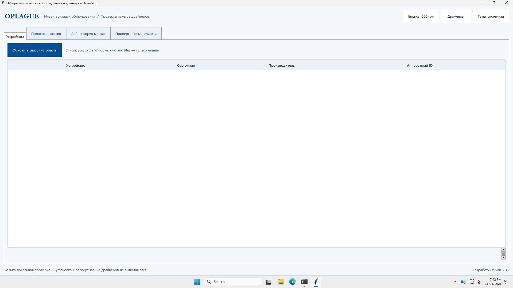
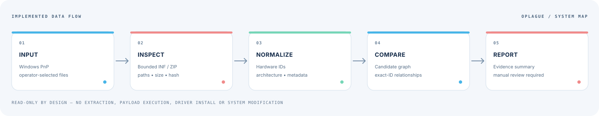

<picture><source media="(prefers-color-scheme: dark)" srcset="assets/readme/hero-banner-dark.svg"><source media="(prefers-color-scheme: light)" srcset="assets/readme/hero-banner-light.svg"></picture>

<h1 align="center">OPlague — рабочая станция устройств, драйверов и игровой производительности</h1>

<strong>Локальное Windows-приложение для ограниченной проверки устройств и драйверов, формирования отчётов с доказательствами и обратимой настройки игрового сеанса.</strong>

  

[Быстрый старт](#быстрый-старт) · [Revival](#обновление-документации-revival) · [Визуальный обзор](#визуальный-обзор) · [Архитектура](#архитектура) · [Документация](docs/README.md)

> **Граница безопасности:** проверка драйверов и пакетов работает в режиме чтения: payload не распаковывается, не исполняется, не устанавливается и не загружается. Совпадение hardware ID — кандидат, а не сертификация совместимости. Отдельный игровой сеанс может временно выбрать встроенный план питания Windows после сохранения снимка; восстановление защищено от перезаписи последующих внешних изменений.

## Быстрый старт

**Требования:** Python 3; для live Plug and Play-инвентаризации нужна Windows. Сохранённые отчёты и метаданные пакетов можно анализировать офлайн. Для desktop UI нужен Tkinter.

~~~sh
git clone https://github.com/Ivan-VHS/OPlague.git
cd OPlague
python oplague_app.py
~~~

Тесты и проверка визуального контракта:

~~~sh
python -m compileall -q oplague_app.py oplage_app.py tests
python tools/validate_visual_canon.py ui_theme.py
python -m unittest discover -s tests -v
~~~

Полезные CLI-проверки:

~~~sh
python -m oplague --verify
python -m oplague --catalog
python -m oplague --search "ballistic"
python -m oplague --profile 5
python -m oplague --rank reach
~~~

## Обновление документации Revival

| Было | Стало |
|---|---|
| Статичный обзор без ясных ролей изображений | Адаптивный баннер и отдельно подписанные снимок/архитектурная схема |
| Анализ драйверов и игровые настройки выглядели как единый уровень доступа | Read-only проверка отделена от явного обратимого изменения power plan |
| Описания возможностей без единого языка зрелости | Матрица функций с границами источников, данных и безопасности |
| Быстрый старт смешивался с операционными деталями | Проверенные команды запуска, тестов и CLI вынесены наверх |
| Ссылки разбросаны по длинному тексту | Тематические хабы, индекс документации и стандарт публикации |

Это обновление документации, **не версия ПО и не объявление о релизе**. Источниками истины остаются код, тесты, схемы и актуальные CI workflow.

## Реализованный функционал

| Область | Текущая функция | Граница |
|---|---|---|
| Инвентаризация устройств | Сбор Windows Plug and Play identity/status | Live inventory только в Windows |
| INF / ZIP | Ограниченный разбор метаданных, путей, hashes и architecture hints | Без распаковки и исполнения |
| Authenticode | Метаданные подписи, signer и timestamp для выбранных файлов | Не подтверждает безопасность и не устанавливает драйвер |
| Совместимость | Кандидаты по точному нормализованному hardware ID | Только evidence для ручной проверки |
| UDRV v1 | Проверка manifest, размеров файлов и SHA-256 | Без установки и загрузки |
| Отчёты и snapshots | Версионированный JSON, batch summaries и offline compare | Локальные данные; hash не подтверждает издателя |
| Игровой сеанс | Snapshot, временный встроенный power plan и guarded restore | Не разгон GPU, не меняет драйвер или firmware |
| Метрики | Взвешенное расстояние и сравнение профилей | Рекомендательная оценка, не сертификация |

## Визуальный обзор

<table><tr><td width="50%">
<strong>Реальный снимок приложения</strong> — Windows desktop, 1920×1080.
</td><td width="50%">
<strong>Архитектурная иллюстрация</strong> — схема evidence pipeline, не снимок UI.
</td></tr></table>

## Архитектура

~~~mermaid
flowchart LR
  A[Windows PnP / локальный пакет] --> B[Ограниченный metadata parser]
  B --> C[Проверенная запись evidence]
  C --> D[Candidate matching и review]
  D --> E[Dry-run report]
  E --> F[Явный JSON export]
  G[Сохранённый device snapshot] --> D
  H[Gaming session] --> I[Snapshot power plan]
  I --> J[Временный встроенный plan]
  J --> K[Guarded restore]
~~~

Проверка драйверов и игровой сеанс — разные потоки. Driver pipeline не устанавливает, не загружает, не распаковывает и не исполняет содержимое пакета.

## Конфигурация и доступ

Hosted service, API token, аккаунт, root .env или тестовый логин не требуются. Live inventory использует локальные Windows PowerShell/CIM. При недоступности провайдера приложение показывает ошибку инвентаризации и не подставляет фиктивный список устройств.

В desktop UI доступны палитра Duck и motion preferences. Изменение системного power plan относится только к отдельному явному игровому сценарию.

## Структура репозитория

| Путь | Назначение |
|---|---|
| oplague_app.py | Публичная точка входа desktop-приложения |
| oplage_app.py | Реализация desktop UI и логики инспекции |
| tools/ | CLI, отчёты, метрики и UDRV utilities |
| tests/ | Unit и regression-тесты с синтетическими fixtures |
| schemas/ | Версионированные отчёты и package contracts |
| docs/ | Архитектура, безопасность, интеграции и operator references |
| assets/readme/ | Адаптивный баннер и workflow-иллюстрация |
| assets/screenshots/ | Снимки Windows-приложения |
| .github/workflows/ | CI, Windows packaging и quality gates |

## Проверки и статус

~~~sh
python -m unittest discover -s tests -v
python -m oplague --verify
python tools/udrv_inspector.py path/to/package.udrv --json
git diff --check
~~~

Текущие возможности и ограничения: [матрица функций](docs/FEATURES.md), [архитектура](docs/ARCHITECTURE.md), [хаб проверки устройств и драйверов](docs/clusters/device-driver-inspection.md) и [карта документации](docs/INFORMATION_ARCHITECTURE.md). Heuristic или совпадение не являются verdict о вредоносности или certification устройства.

## Разработка и безопасность

Перед изменением parser, системных интеграций и safety controls прочитайте [CONTRIBUTING.md](CONTRIBUTING.md). Правила публикации — в [README Visual Standard](docs/README_VISUAL_STANDARD.md), политика безопасности — в [SECURITY.md](SECURITY.md).

## Лицензия

[Apache-2.0](LICENSE).
