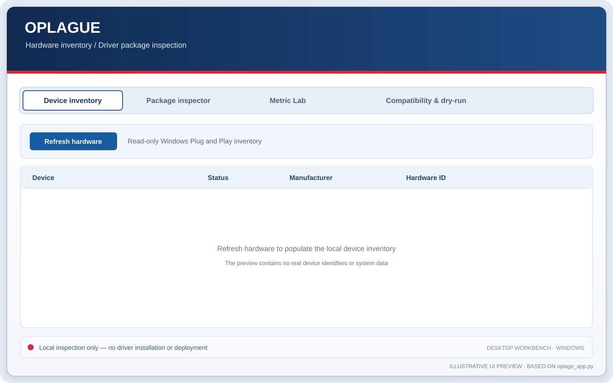
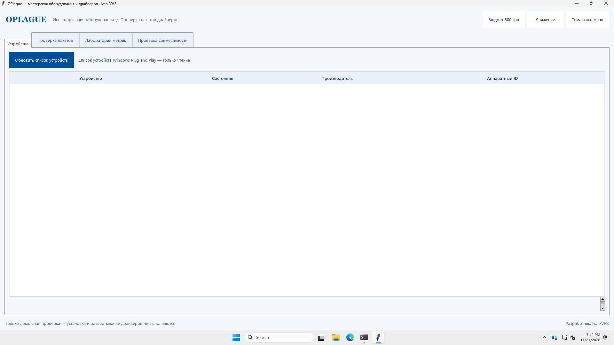

[English](README.md) · [Українська](README.uk.md) · [Русский](README.ru.md) · [简体中文](README.zh-CN.md)

<h1 align="center"><strong>🛡️ OPlague — робоча станція пристроїв, драйверів та ігор</strong></h1>

  

> **Перевіряй пристрої та пакунки. Не змінюй систему. Публікуй докази, а не дії з драйверами.**

**Стан:** Розробка · інструменти перевірки з пріоритетом Windows · **Версія:** Version not declared in project contract · **License:** [Apache-2.0](LICENSE) · **Стандарт README:** Psychoporter 666 v1.0 · **Дата перевірки:** 2026-11-25 · UTC · **Source:** [Ivan-VHS/OPlague](https://github.com/Ivan-VHS/OPlague)

## Швидка навігація

[🚀 Demo: workbench screenshot](assets/screenshots/oplague-workbench.png) · [Documentation](docs/README.md) · [Source repository](https://github.com/Ivan-VHS/OPlague) · [Issues](https://github.com/Ivan-VHS/OPlague/issues)

## Призначення та межі

Локальна робоча станція для виявлення пристроїв лише на читання, обмеженої перевірки пакетів INF/ZIP/UDRV, аналізу сумісності та ігрової телеметрії. Поточне виявлення Windows Plug-and-Play доступне лише у Windows; аналіз збережених файлів і звітів переносний. Застосунок не встановлює, не вмикає, не вивантажує й не змінює драйвери.

## Можливості

- Інвентаризація Windows Plug-and-Play через запити лише на читання.
- Обмежений аналіз INF/ZIP, метадані PE та Authenticode, SHA-256 і SPDX-інвентаризація.
- Перевірка маніфесту UDRV v1, розмірів файлів, хешів і шляхів; payload не встановлюється й не запускається.
- Кандидати зв’язків за точним нормалізованим hardware ID; це не сертифікація сумісності.
- Локальний аналіз ігрової продуктивності/frametime та read-only телеметрія NVIDIA через nvidia-smi, якщо доступна.
- Версіоновані JSON-знімки пристроїв і необов’язкова перевірка через довірений C ABI Pytyliki.

## Архітектура та потік даних

~~~mermaid
flowchart TB
  U["User-selected device or file"] --> I["Bounded inspector"]
  I --> N["Normalize IDs / metadata / hashes"]
  N --> E["Evidence and candidate graph"]
  E --> R["Local report / JSON snapshot"]
  G["nvidia-smi — read only"] --> T["GPU telemetry snapshot"]
  T --> R
  R -.-> X["No driver install, load or certification"]
~~~

Source code, schemas, build files, tests and CI are the evidence for implemented behavior. Roadmap entries and catalogue records describe plans or inventories, not shipped functionality.

## Вимоги

Python 3.10–3.12 для поточних desktop-інструментів і перевірок. Для поточної інвентаризації Plug-and-Play потрібна Windows; offline-аналіз файлів і звітів не потребує доступу до пристроїв. Доступність Tk-інтерфейсу залежить від локальної інсталяції Python.

## Збирання

~~~sh
python -m venv .venv
. .venv/bin/activate
python -m pip install --upgrade pip
python oplague_app.py
~~~

## Перші перевірки

~~~sh
python -m unittest discover -s tests -v
python tools/udrv_inspector.py path/to/package.udrv --json
~~~

Запускайте desktop-точку входу після перевірки тестів і виводу інспектора. Інспектор не розпаковує та не запускає вміст пакунка.

## Запуск

The current desktop entry point is oplague_app.py. The package inspector accepts a user-selected local file; it does not execute package payloads.

## Інтерфейси

| Surface | Contract / entry point | Boundary |
|---|---|---|
| Device snapshot | `oplage.device-snapshot.v1` | Versioned JSON; pseudonymous device fingerprint. |
| GPU telemetry | `oplage.gpu-telemetry.v1` | Read-only NVIDIA sensor export; unavailable values remain unknown. |
| UDRV inspector | `tools/udrv_inspector.py` | Manifest, size, hash and path checks; no install/load. |
| Native metrics | `Optional pytyliki.c-abi.v1` | Only through an explicitly selected trusted library. |

REST/GraphQL, WebSocket, OAuth, хмарний deployment і cookie-механізми не описуються як можливості, якщо в репозиторії немає версіонованої реалізації та тестів.

## Безпека та межі довіри

Імпортовані файли та пакунки вважаються недовіреними. Кількість записів архіву, шляхи, розміри й ступінь стиснення обмежені; payload не розпаковується та не виконується. Збіги hardware ID — лише кандидати, а не висновки щодо підпису, безпеки чи підтримки ОС. Виявлення пристроїв працює на читання; драйвери, прошивки й стан пристроїв не змінюються.

Security reporting: [SECURITY.md](SECURITY.md). Do not publish secrets, device identifiers or private logs in public issues.

## Перевірка якості

~~~sh
python -m unittest discover -s tests -v
~~~

Склад тестів визначається зареєстрованими CTest/unittest цілями та workflow. Відсоток покриття, fuzz-результат і звіт навантаження не заявляються без опублікованого артефакту.

## Докази продуктивності

Ігрові та GPU-метрики — локальні спостереження, а не універсальні бенчмарки. Телеметрія NVIDIA працює лише на читання й містить джерело даних; відсутні вимірювання залишаються unknown. Фіксовані значення затримки та споживання пам’яті не заявляються.

## Сумісність

Поточна інвентаризація Windows Plug-and-Play доступна лише у Windows. Offline-перевірка пакунків, хешів, схем і звітів переносна з урахуванням локального середовища Python та необов’язкових платформних джерел даних.

## Документація та екосистема

- [Features and limits](docs/FEATURES.md)
- [Architecture](docs/ARCHITECTURE.md)
- [Authenticode inspection](docs/AUTHENTICODE.md)
- [UDRV v1 format](docs/UDRV_FORMAT_V1.md)
- [GPU telemetry bridge](docs/GPU_TELEMETRY_BRIDGE_V1.md)
- [Gaming workbench](docs/GAMING_PERFORMANCE_WORKBENCH.md)
- [Documentation index](docs/README.md)

Основні технічні джерела — межі можливостей, схема UDRV, перевірка Authenticode та read-only GPU telemetry bridge.

Cross-project integrations use documented versioned interfaces and explicit adapters. An optional adapter does not grant another project runtime or hardware privileges.

## Участь у розробці

Ознайомтеся з CONTRIBUTING.md перед зміною коду або контрактів. Робіть зміни невеликими й перевірними, додавайте детерміновані тести та використовуйте Conventional Commits, якщо цього вимагає посібник.

## Ліцензія та правові умови

Поширюється за ліцензією [Apache-2.0](LICENSE). Програмне забезпечення надається «ЯК Є» в межах умов ліцензії. Назви сторонніх проєктів і торговельні марки належать їхнім правовласникам.

This repository documents local software interfaces. Hosted-service terms, cookie consent, OAuth and CORS are not applicable to the runtime surfaces described above unless a separate hosted component is introduced and documented.

---

Psychoporter 666 README Standard v1.0 · Ivan-VHS · 2026-11-25 · UTC
