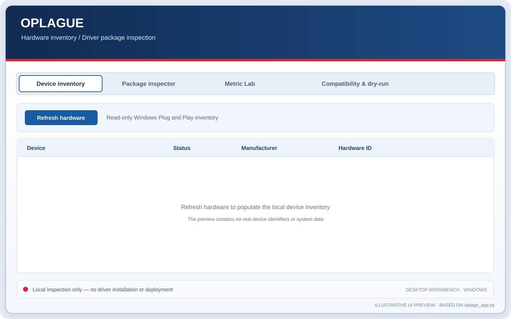
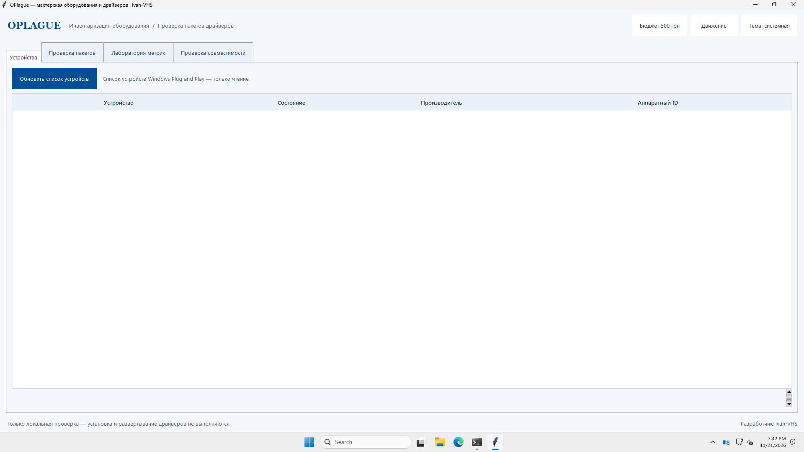

# OPlague — 设备、驱动与游戏性能工作台

[English](README.md) · [Українська](README.uk.md) · [Русский](README.ru.md) · [简体中文](README.zh-CN.md)

  

> **检查设备与软件包，保持系统不变；输出证据，而不是驱动操作。**

**项目状态:** 开发中 · 以 Windows 为主的检查工具 · **版本:** 项目契约未声明版本号 · **License:** [Apache-2.0](LICENSE) · **README 标准:** Psychoporter 666 v1.0 · **审阅日期:** 2026-11-25 · UTC · **Source:** [Ivan-VHS/OPlague](https://github.com/Ivan-VHS/OPlague)

## 快速导航

[🚀 Demo: workbench screenshot](assets/screenshots/oplague-workbench.png) · [Documentation](docs/README.md) · [Source repository](https://github.com/Ivan-VHS/OPlague) · [Issues](https://github.com/Ivan-VHS/OPlague/issues)

## 目标与范围

本地工作台，用于只读设备发现、有界 INF/ZIP/UDRV 软件包检查、兼容性证据和游戏遥测。实时 Windows Plug-and-Play 发现仅适用于 Windows；保存文件与报告分析具有可移植性。应用不会安装、启用、卸载或修改驱动程序。

## 功能

- 通过只读查询盘点 Windows Plug-and-Play 设备。
- 有界 INF/ZIP 检查、PE 与 Authenticode 元数据、SHA-256 和 SPDX 清单。
- 验证 UDRV v1 清单、文件大小、哈希和路径；不会安装或执行软件包内容。
- 按精确标准化硬件 ID 建立候选关联；候选结果不是兼容性认证。
- 本地游戏/帧时间分析，以及在可用时通过 nvidia-smi 导出只读 NVIDIA 遥测。
- 版本化 JSON 设备快照，以及可选的可信 Pytyliki C ABI 交叉检查。

## 架构与数据流

~~~mermaid
flowchart TB
  U["User-selected device or file"] --> I["Bounded inspector"]
  I --> N["Normalize IDs / metadata / hashes"]
  N --> E["Evidence and candidate graph"]
  E --> R["Local report / JSON snapshot"]
  G["nvidia-smi — read only"] --> T["GPU telemetry snapshot"]
  T --> R
  R -.-> X["No driver install, load or certification"]
~~~

源码、架构模式、构建配置、测试和 CI 是已实现行为的依据。路线图和目录仅描述计划或清单，不代表已交付功能。

## 环境要求

当前桌面和验证工具需要 Python 3.10–3.12。实时 Plug-and-Play 盘点需要 Windows；离线文件检查和报告分析不需要访问实时设备。Tk 桌面界面是否可用取决于本地 Python 安装。

## 构建

~~~sh
python -m venv .venv
. .venv/bin/activate
python -m pip install --upgrade pip
python oplague_app.py
~~~

## 首次检查

~~~sh
python -m unittest discover -s tests -v
python tools/udrv_inspector.py path/to/package.udrv --json
~~~

检查测试和检查器输出后再启动桌面入口。软件包检查器不会解压或执行载荷。

## 运行

当前桌面应用入口为 `oplague_app.py`。软件包检查器接收用户选择的本地文件，不会执行软件包载荷。

## 接口

| Surface | Contract / entry point | Boundary |
|---|---|---|
| Device snapshot | `oplage.device-snapshot.v1` | Versioned JSON; pseudonymous device fingerprint. |
| GPU telemetry | `oplage.gpu-telemetry.v1` | Read-only NVIDIA sensor export; unavailable values remain unknown. |
| UDRV inspector | `tools/udrv_inspector.py` | Manifest, size, hash and path checks; no install/load. |
| Native metrics | `Optional pytyliki.c-abi.v1` | Only through an explicitly selected trusted library. |

若仓库中没有版本化实现和测试，则不将 REST/GraphQL、WebSocket、OAuth、云部署或 Cookie 机制描述为现有功能。

## 安全与信任边界

导入文件和软件包均视为不可信输入。归档条目数、路径、大小和压缩率均受限制；不会解压或执行载荷。硬件 ID 匹配只是候选证据，不代表签名、安全或操作系统支持结论。设备发现为只读，不更改驱动、固件或设备状态。

安全策略：[SECURITY.md](SECURITY.md)。请勿在公开问题中发布密钥、设备标识符或私人日志。

## 质量验证

~~~sh
python -m unittest discover -s tests -v
~~~

测试范围由已注册的 CTest/unittest 目标和工作流定义。没有公开报告时，不声明覆盖率百分比、模糊测试结果或负载测试报告。

## 性能证据

游戏和 GPU 指标是本地观测，不是通用基准。NVIDIA 遥测为只读并记录数据来源；缺失测量保持未知。不声明固定延迟或内存占用。

## 兼容性

实时 Windows Plug-and-Play 盘点仅适用于 Windows。离线软件包、哈希、Schema 和报告检查具有可移植性，但取决于本地 Python 环境和可选的平台证据来源。

## 文档与生态

- [功能与限制](docs/FEATURES.md)
- [架构](docs/ARCHITECTURE.md)
- [Authenticode 检查](docs/AUTHENTICODE.md)
- [UDRV v1 格式](docs/UDRV_FORMAT_V1.md)
- [GPU 遥测桥接](docs/GPU_TELEMETRY_BRIDGE_V1.md)
- [游戏工作台](docs/GAMING_PERFORMANCE_WORKBENCH.md)
- [文档索引](docs/README.md)

主要技术参考包括功能边界、UDRV 格式、Authenticode 检查和只读 GPU 遥测桥接。

跨项目集成使用有文档说明的版本化接口和显式适配器。可选适配器不会授予其他项目运行时权限或硬件访问权限。

## 参与贡献

修改代码或契约前请阅读 [CONTRIBUTING.md](CONTRIBUTING.md)。保持改动可审查，添加确定性测试，并按贡献指南使用 Conventional Commits。

## 许可证与法律说明

本项目依据 [Apache-2.0](LICENSE) 许可。软件按许可条款以“按现状”方式提供。第三方项目名称与商标归其各自权利人所有。

本仓库记录的是本地软件接口。除非另行引入并记录托管服务，否则云服务条款、Cookie 同意、OAuth 和 CORS 均不适用于上述本地运行组件。

---

Psychoporter 666 README Standard v1.0 · Ivan-VHS · 2026-11-25 · UTC

