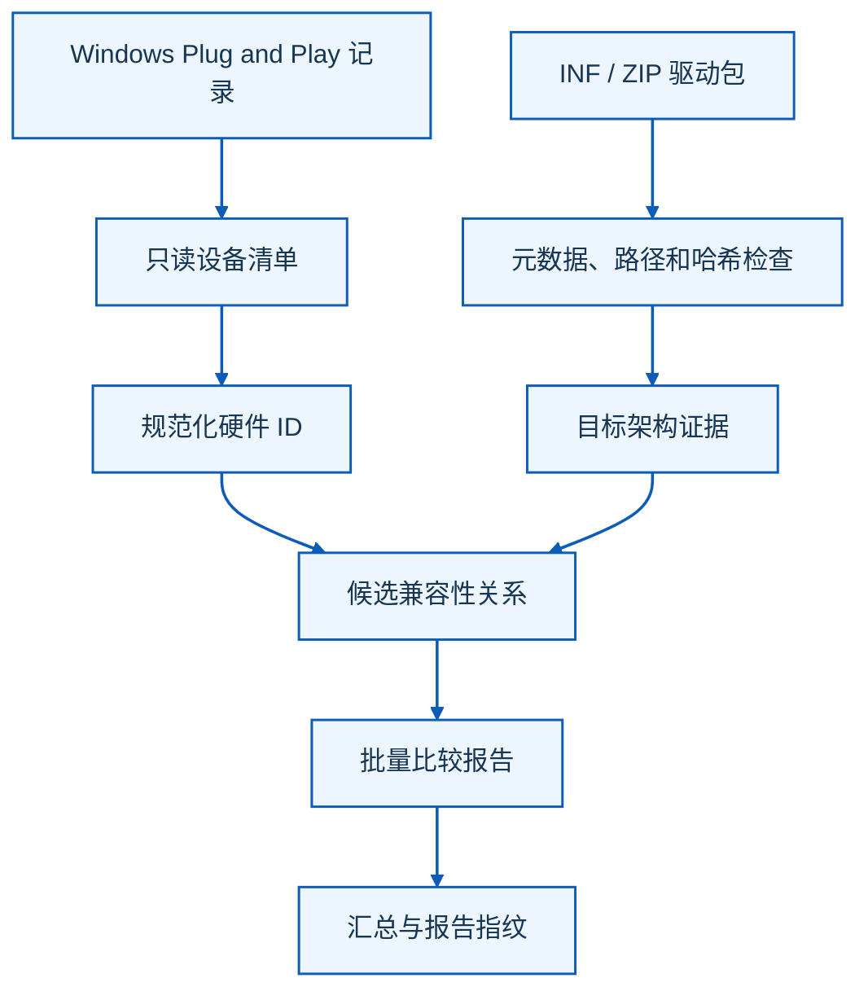
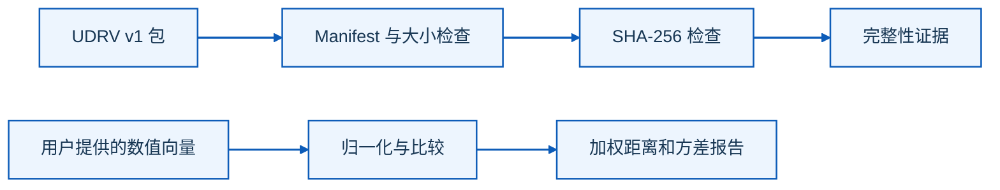

# OPlague — 驱动工作台

[English](README.md) · [Українська](README.uk.md) · [Русский](README.ru.md) · [简体中文](README.zh-CN.md)

<p align="center"></p>
<sub>项目视觉概览 · README 更新于 2026-11-22 · 项目配色 · 清晰的数据图表</sub>


[Windows 桌面构建](https://github.com/Ivan-VHS/OPlague/actions/workflows/desktop-build.yml) · [CI](https://github.com/Ivan-VHS/OPlague/actions) · Python 3.10+ · Windows · Apache-2.0
**开发者：** [Ivan-VHS](https://github.com/Ivan-VHS)

**OPlague 是只读工作台：用于 Windows 设备盘点、驱动包检查和基于证据的比较。它不会安装、加载或修改驱动。**


## Windows 实际运行截图

<p align="center"></p>

<sub>应用实际截屏 · 原始图像为 1920×1080 · 保留原始像素，不进行人为放大。</sub>

设备与驱动包之间的关联仅作为供操作人员审查的证据；程序不会启动驱动安装。

## 功能数据流

该图概述 Windows 设备记录、驱动包检查和报告生成之间已经实现的数据流转。



## 软件包检查与指标处理

第二张图描述软件包完整性检查，以及对用户提供数值向量的分析。



## 工作台模块

| 模块 | 证据 / 输出 | 边界 |
|---|---|---|
| 设备盘点 | Plug and Play 身份、状态和硬件 ID | 只读检测 |
| INF / ZIP 检查 | 元数据、哈希、路径和资源限制 | 不执行软件包、不安装驱动 |
| 架构检查 | INF target 与主机架构比较 | 证据，不是兼容性结论 |
| 兼容性图 | 精确规范化的硬件 ID 关系 | 仅为候选关系 |
| UDRV v1 | manifest、载荷大小和 SHA-256 | 完整性检查；不安装/加载 |
| DRIVE-LENS | 来源记录、HMAC 假名及属性/时间窗口分组 | 不自动判定 |
| 批量报告 | 有序结果、汇总和报告 fingerprint | 不写入系统 |
| Metric Lab | 归一化向量、加权距离和方差 | 对用户提供的数据进行分析 |
| Clinical Systems | 120 条原则记录和 36 项遥测检查 | 操作建议，不是医疗或设备认证 |
| Impact Profiles | 20 个可搜索语义配置及五个序数维度 | 仅词汇目录；不推断硬件信息 |

## 运行与测试

启动 Windows 桌面工作台：

```sh
python oplague_app.py
```

运行测试并检查语义配置目录：

```sh
python -m unittest discover -s tests -v
python -m oplague --verify
python -m oplague --catalog
python -m oplague --search "баллистический"
python -m oplague --profile 5
python -m oplague --rank reach
python tools/udrv_inspector.py path/to/package.udrv --json
python tools/clinical_systems.py --catalog --pretty
```

Windows 工作流会检查视觉规范并运行测试，构建独立的 `OPlague.exe`，捕获实际运行中的应用界面，并发布 Windows x64 压缩包。

## 数值参考

| INF target | PE machine |
|---|---:|
| NTx86 | `0x014C` |
| NTamd64 | `0x8664` |
| NTarm | `0x01C4` |
| NTarm64 | `0xAA64` |
| NTia64（旧版） | `0x0200` |

UDRV v1 限制：manifest ≤4 MiB · ≤10,000 项 · 单文件 ≤512 MiB · 总载荷 ≤2 GiB · SHA-256 缓冲区 1 MiB。

ID 或哈希匹配不证明发布者可信、系统兼容、设备适用或安装安全。HMAC 假名和报告 fingerprint 有助于保持一致性与来源记录，但本身不能证明真实性。

[文档索引](docs/README.md) · [Apache-2.0 许可证](LICENSE)


## 预算分配参考
这是一个 500 UAH 预算模型示例，包含 JSON 契约和离线模拟器。它属于文档示例，并非宿主应用运行时功能。

[多语言指南](docs/RESOURCE_ALLOCATION_500_UAH.md) · [交互式模拟器](docs/resource-allocation-500-uah.html) · [JSON 示例](examples/resource-allocation-500-uah.json) · [JSON Schema](schemas/resource-allocation.v1.schema.json)
